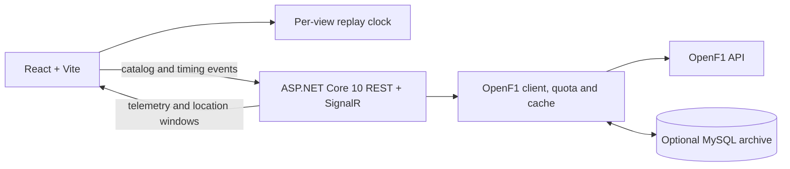

# F1 Race Intelligence

F1 Race Intelligence is an independent motorsport portfolio project that replays recorded Formula 1 sessions. Explore the driver grid, reconstruct circuit traces, and inspect timing and telemetry on a shared replay clock.

## What you can explore

- An editorial overview with GSAP scroll transitions, original single-seater artwork, a race countdown and an interactive driver carousel.
- A Three.js studio with an original procedural car, three camera angles, orbit, zoom and optional auto-rotation.
- Driver profiles with team colors, licensed portraits where available, and session statistics.
- Race Control with classification, gaps, lap and sector times, tyres, pit stops, conditions and race direction messages.
- Approximate circuit reconstruction from recorded locations in 2D and 3D, including interpolated markers, zoom and driver follow.
- Driver instruments, speed traces, independently estimated lap-distance overlays and braking onset comparisons.
- Team radio clips with manual playback and seek links, subject to the source's coverage.
- A calendar and historical replay controls with speed settings from 0.5× through 10×.

## Architecture



The frontend uses React, TypeScript, Vite and Tailwind CSS. Three.js, React Three Fiber and Drei render the car and circuit. GSAP and ScrollTrigger drive the opening, Motion handles view transitions, Lenis handles smooth scrolling, Recharts renders traces and Lucide supplies interface icons.

The server is split into API, Application, Domain, Infrastructure and Tests projects. It uses ASP.NET Core Web API, SignalR, Serilog, Swagger/OpenAPI, HttpClientFactory, EF Core with Pomelo/MySQL and a background database migration service.

The service applies a shared outbound request quota, coalesces identical requests, bounds and retries upstream requests, and deduplicates records. Successful historical responses can be persisted in MySQL. Each replay view owns its clock and selects only timing events at or before that instant. Location and telemetry load through SignalR in short windows, with a REST fallback. Lap comparisons integrate recorded speed over time to estimate distance. The resulting traces can diverge where samples are sparse.

## Run locally

Install Node.js 22 or a supported equivalent and the .NET 10 SDK. Start the backend and frontend in separate terminals.

```sh
npm ci
dotnet run --project server/API/F1RaceIntelligence.API.csproj --urls http://127.0.0.1:5050
```

```sh
npm run dev
```

Open [the local frontend](http://127.0.0.1:5173/) or [API documentation](http://127.0.0.1:5050/swagger).

### MySQL

For a single local container setup, copy `.env.example` to `.env`, then run `docker compose up --build` and open [the local application](http://127.0.0.1:8080/). The Compose configuration starts MySQL, creates a local database, and passes the connection to the app. The background service applies the archive migration.

For an existing MySQL 8 server, create a database and grant the application account permission to create its schema and read and write archive rows. Set `ConnectionStrings__Archive` before starting the API. If it is omitted, history is cached in memory for the process lifetime.

| Variable | Purpose |
| --- | --- |
| `ConnectionStrings__Archive` | Optional MySQL connection string |
| `OpenF1__AccessToken` | Optional OpenF1 bearer token, supplied server-side |
| `OpenF1__BaseUrl` | Optional upstream endpoint, defaults to the official OpenF1 REST v1 URL |

### Internal API

| Route | Purpose |
| --- | --- |
| `GET /health` | Application liveness |
| `GET /api/status` | Data provider and whether a live credential is configured |
| `GET /api/feed/season_drivers?year=2025` | Supplemental season entries and nationalities from Jolpica F1 |
| `GET /api/feed/{stream}?year=2025` | Season meetings and sessions, which also accept `meeting` and `session` |
| `GET /api/feed/{stream}?session=…&driver=…` | Session roster, timing, laps, pit, stints, weather, race control, results, grid, overtakes, radio and championship feeds |
| `GET /api/feed/{stream}?session=…&driver=…&start=…&end=…` | `location` and `car_data` using UTC ISO-8601 bounds. Car data requires a driver |
| `/hubs/replay` | SignalR endpoint. `StreamWindow(session, driver, start, end)` streams recorded location and selected-driver telemetry |

## Verification

```sh
npm run build
dotnet test server/Tests/F1RaceIntelligence.Tests.csproj
npx playwright install chromium
npm run test:e2e
```

Browser CI uses a synthetic fixture server. Set `E2E_REAL=1` to run the same flows against OpenF1 through the real backend. Set `E2E_RUNNING=1` when both development servers are already running. The GitHub Actions workflow checks the frontend, backend and browser flows.

## Hosting

The multi-stage Dockerfile builds the frontend and serves it from the same origin as the API and SignalR. It listens on port `8080`. The Render Blueprint uses a free web service and memory cache by default. Sign in to Render to review and deploy the Blueprint. MySQL can be added by supplying an existing database connection as a secret. See [Render's free-tier documentation](https://render.com/docs/free).

[Review the free Render deployment](https://render.com/deploy?repo=https://github.com/ViniMartins10/f1-race-intelligence).

## Data coverage

- OpenF1 provides historical data from 2023 onward. Anonymous requests can temporarily become unavailable during live sessions. Historical playback requires no paid plan. Authenticated live ingestion and a live viewer are future extensions. The backend has a server-side bearer configuration seam.
- Portraits and timing profiles follow the selected session. The Drivers view also offers the season entries from Jolpica. Some drivers lack a verified licensed photograph. Radio, results, tyre compounds and telemetry can be missing or incomplete. The site displays unavailable fields explicitly.
- Circuit geometry is a reconstruction from one recorded lap. Markers represent the location feed, sectors require source data and distance is estimated from recorded speed. The project does not claim geographic precision.
- Constructor and championship pages, sector overlays, and automated live streaming are outside the current interface.

## Screenshots and demo

See [desktop preview](docs/screenshots/overview-desktop.png), [mobile preview](docs/screenshots/overview-mobile.png), [Single-seater studio](docs/screenshots/car-studio.png), [Race Control](docs/screenshots/race-control.png) and [Telemetry](docs/screenshots/telemetry.png). A public demo URL and video can be added after deployment.

## Credits

Timing and radio metadata come from [OpenF1](https://openf1.org/docs/). Season entries and nationalities are from [Jolpica F1](https://github.com/jolpica/jolpica-f1). Individual image licenses and authors are recorded in [the portrait credits](public/portraits/credits.json) and shown in the site's Data & Credits view. Some portraits show earlier seasons. The car model is original procedural artwork. The opening image was generated for this project with ImageGen. The visual reference was [Lando Norris's website](https://landonorris.com/).

F1 Race Intelligence is an educational, independent project with no official association with Formula 1, FIA, any driver or any team.

<details>
<summary>ImageGen prompt for the opening artwork</summary>

Wide 3:2 premium motorsport web hero photograph with an original unbranded graphite-black Formula single-seater race car and muted safety-lime angular livery strips, low dramatic front three-quarter view, front wing facing slightly left and toward camera, car large entirely within right two-thirds, front wing near lower center. The leftmost third is completely dark empty black to reserve for text overlay. Dramatic thin lime and cool-white studio rim lighting on carbon fiber, glossy dark asphalt with a little green reflection, speed blur streaks and fine lens grit in the background, deeply shadowed surroundings, cinematic commercial racing photography. Realistic proportions, four exposed black slick tires, contemporary halo cockpit. No words, no typography, no logos, no watermark.

</details>
